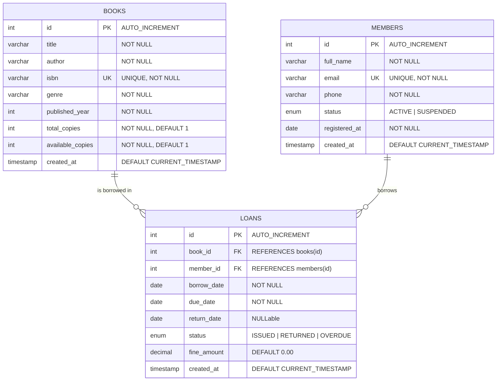

# 📚 BookHaven — Console Library Management System
### *A Complete, Production-Ready Console Application in Java, JDBC, and MySQL*

---

## 📖 Project Overview & Purpose

**BookHaven** is an attractive, beginner-friendly yet architecturally robust console application designed to manage everyday library operations. Built using **core Java (JDK 17+)**, **JDBC (Java Database Connectivity)**, and **MySQL 8.0+**, it demonstrates clean software engineering principles:
* **Separation of Concerns**: Layered architecture (UI Layer, Service Layer, DAO Layer, Model/Entity Layer, Config Layer).
* **ACID Transactions**: Atomic checkout and return operations ensuring inventory consistency.
* **Security & Best Practices**: JDBC `PreparedStatement` across all queries to prevent SQL Injection, and externalized database credentials (never hardcoded in source files).
* **Attractive Terminal Experience**: Rich ASCII menus, dynamic table renderers, and ANSI color coding.
* **Zero Friction**: Automatic database & table initialization, bundled MySQL Connector/J driver, and self-healing connection configuration.

---

## 🚀 Key Features & Full CRUD Capabilities

| Domain Module | Operations | Description |
|---|---|---|
| **📚 Books Catalog** | **C**reate<br>**R**ead<br>**U**pdate<br>**D**elete | Add new books with ISBN validation, view catalog in styled ASCII tables, search by title/author/genre/ISBN, edit details/inventory, and safely delete books (with active loan checks). |
| **👥 Member Directory** | **C**reate<br>**R**ead<br>**U**pdate<br>**D**elete | Register patrons with validated emails/phones, browse patrons, update profiles, toggle membership status (ACTIVE/SUSPENDED), and view personal borrowing histories. |
| **🔄 Circulation & Loans** | **C**reate (Borrow)<br>**R**ead (Active/Overdue)<br>**U**pdate (Return/Renew) | Borrow books (with automatic inventory deduction and member eligibility validation), return books with dynamic overdue fine computation ($1.00/day), renew loans, and review complete audit trails. |
| **📊 Real-Time Analytics** | **R**ead | Comprehensive library dashboard showing total unique titles, physical copies count, available vs checked out ratios, patron counts, overdue alert badges, and total collected fines. |
| **⚙️ Self-Healing DB** | Diagnostic / Setup | In-app connection tester, interactive credential configuration prompt, and one-click schema/seed re-execution. |

---

## 🗄️ Database Architecture & Relationships

### Entity Relationship (ER) Diagram



---

## 💻 Terminal User Interface & Typical Flow

```
 ===========================================================================
  ____              _     _   _                            
 | __ )  ___   ___ | | __| | | | __ ___   _____ _ __       
 |  _ \ / _ \ / _ \| |/ /| |_| |/ _` \ \ / / _ \ '_ \      
 | |_) | (_) | (_) |   < |  _  | (_| |\ V /  __/ | | |     
 |____/ \___/ \___/|_|\\_\|_| |_|\__,_| \_/ \___|_| |_|     
            LIBRARY MANAGEMENT CONSOLE SYSTEM              
 ===========================================================================
  Modern Java + JDBC + MySQL Edition | High-Performance PreparedStatements

+-------------------------------------------------------------------------+
|                               MAIN MENU                                 |
+-------------------------------------------------------------------------+
  [1] 📚 Book Catalog Management   (Add, View, Search, Update, Delete)
  [2] 👥 Member Management         (Register, List, Search, Edit, Delete)
  [3] 🔄 Circulation & Loans       (Borrow, Return, Renew, Overdue Tracker)
  [4] 📊 Analytics & Dashboard     (Real-time Inventory & Financial Stats)
  [5] ⚙️  Database & Settings       (Test Connection, Configure Credentials)
  [6] 🚪 Exit Application
+-------------------------------------------------------------------------+
```

### Formatted Output Sample (Table Display)

```
  +----+------------------------------------+------------------+----------------------+------+-----------+-------+-----------------+
  | ID | Title                              | Author           | Genre                | Year | Available | Total | ISBN            |
  +----+------------------------------------+------------------+----------------------+------+-----------+-------+-----------------+
  | 1  | Clean Code: A Handbook of Agile... | Robert C. Martin | Software Engineering | 2008 | 4         | 5     | 978-0132350884  |
  | 2  | The Pragmatic Programmer: Your ... | David Thomas...  | Computer Science     | 2019 | 3         | 4     | 978-0135957059  |
  | 7  | 1984                               | George Orwell    | Dystopian Fiction    | 1949 | 4         | 5     | 978-0451524935  |
  +----+------------------------------------+------------------+----------------------+------+-----------+-------+-----------------+
  Total Records: 3
```

---

## 📁 Project Directory Structure

```
c:/Users/jeqba/Downloads/New folder/
├── compile.bat                  # One-click Windows compilation script
├── run.bat                      # One-click Windows run script (auto-compiles)
├── run.ps1                      # PowerShell run script with UTF-8 encoding
├── db.properties                # Local active database configuration
├── db.properties.example        # Configuration template
├── README.md                    # Project documentation (this file)
├── .gitignore                   # Ignores bin/ and private credentials
├── .vscode/
│   ├── settings.json            # VS Code Java settings (source path & referenced JARs)
│   ├── launch.json              # VS Code run config (integrated terminal for Scanner input)
│   └── tasks.json               # VS Code build and run tasks
├── lib/
│   └── mysql-connector-j-8.4.0.jar  # Bundled MySQL Connector/J driver
├── sql/
│   └── schema.sql               # Complete SQL schema DDL and initial sample data
└── src/
    └── com/
        └── library/
            ├── Main.java               # Application bootstrap & shutdown hooks
            ├── config/
            │   ├── DatabaseConfig.java      # Reads db.properties and env variables
            │   └── DatabaseConnection.java  # Connection factory & auto-migration
            ├── model/
            │   ├── Book.java                # Book entity POJO
            │   ├── Member.java              # Member entity POJO
            │   └── Loan.java                # Loan entity POJO
            ├── dao/
            │   ├── BookDAO.java             # Books PreparedStatements CRUD
            │   ├── MemberDAO.java           # Members PreparedStatements CRUD
            │   └── LoanDAO.java             # Loans PreparedStatements & stats
            ├── service/
            │   └── LibraryService.java      # ACID transactions & business rules
            ├── ui/
            │   ├── ConsoleUI.java           # Menus, ANSI color screens & actions
            │   └── TablePrinter.java        # ASCII border dynamic table renderer
            └── util/
                └── InputValidator.java      # Robust console validation utility
```

---

## ⚙️ Configuration & Connection Setup

Credentials are **never hardcoded** in Java source files. You can configure MySQL credentials using either of the following two options:

### Option A: Edit `db.properties` (Recommended)
Open `db.properties` in your text editor:
```properties
db.url=jdbc:mysql://localhost:3306/library_db?createDatabaseIfNotExist=true&useSSL=false&allowPublicKeyRetrieval=true&serverTimezone=UTC
db.user=root
db.password=YOUR_MYSQL_PASSWORD_HERE
db.timeout.seconds=5
```

### Option B: Environment Variables
Alternatively, you can set system environment variables:
* `DB_URL`
* `DB_USER`
* `DB_PASSWORD`

*(Environment variables take precedence over `db.properties` if set.)*

### Option C: Interactive Console Setup
If you launch the application and the connection fails, BookHaven will **prompt you directly in the console** to enter your MySQL username and password, test the connection, and save it to `db.properties` automatically!

---

## 🛠️ Step-by-Step Instructions to Run

### Prerequisites
1. **Java JDK 17 or higher** (Verify with `java -version` and `javac -version`).
2. **MySQL Server 8.0+** running locally (Verify with `Get-Service MySQL80` or MySQL Workbench).

### Step 1: Initialize Database (Automatic or Manual)
* **Automatic**: The application automatically creates `library_db`, all 3 tables, indexes, and initial seed data upon first successful connection!
* **Manual (Optional)**: If you prefer manual SQL setup, open MySQL Command Line Client or MySQL Workbench and run:
  ```bash
  mysql -u root -p < sql/schema.sql
  ```

### Step 2: Compile & Run

#### Using Command Prompt / Double-Click:
Simply run:
```cmd
run.bat
```
*(Or run `compile.bat` first, followed by `run.bat`).*

#### Using PowerShell:
```powershell
.\run.ps1
```

#### Using Direct CLI Commands:
```bash
# 1. Compile
javac -encoding UTF-8 -cp "lib/*" -d bin src/com/library/*.java src/com/library/config/*.java src/com/library/model/*.java src/com/library/dao/*.java src/com/library/service/*.java src/com/library/util/*.java src/com/library/ui/*.java

# 2. Run
java -cp "bin;lib/*" com.library.Main
```

---

## 🛡️ Input Validation & Error Handling Architecture

* **SQL Injection Prevention**: All SQL queries utilize `java.sql.PreparedStatement` with parameterized placeholders (`?`).
* **ACID Transactions**: Book checkout and returns use `Connection.setAutoCommit(false)`, `commit()`, and `rollback()` in a `try-catch-finally` block to protect inventory accuracy.
* **Non-Crashing Console**: `InputValidator` intercepts invalid numbers, letters where numbers are expected, empty strings, invalid email patterns, and out-of-range inputs, providing friendly error feedback rather than crashing with exceptions.
* **Referential Integrity**: Deleting a book with active loans or deleting a member with unreturned books is prevented with descriptive warnings.
